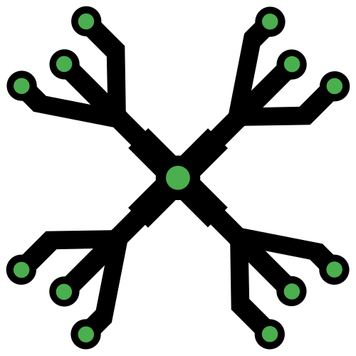

  

<h1 align="center">FORKTEX</h1>

  <b>We build software that ships.</b> 
  Software engineering firm, Bucharest · Europe and North America since 2021 
  <a href="https://forktex.com"><b>forktex.com</b></a>

### Platforms

<table>
  <tr>
    <td align="center" width="50%">
      <a href="https://forktex.com/products/cloud"> <b>Cloud</b></a> 
      Declarative deployment 
      <a href="https://cloud.forktex.com">Open ↗</a>
    </td>
    <td align="center" width="50%">
      <a href="https://forktex.com/products/network"> <b>NetWork</b></a> 
      People and companies 
      <a href="https://network.forktex.com">Open ↗</a>
    </td>
  </tr>
  <tr>
    <td align="center" width="50%">
      <a href="https://forktex.com/products/ai"> <b>AI</b></a> 
      One typed AI API 
      Coming soon
    </td>
    <td align="center" width="50%">
      <a href="https://forktex.com/products/erp"> <b>ERP</b></a> 
      Multi-tenant business 
      Coming soon
    </td>
  </tr>
</table>

### Open source

Eight Python libraries, each on GitHub and PyPI. AGPL-3.0-or-later, or a commercial licence. All build on `forktex`.

<table>
  <tr>
    <td align="center" width="50%">
       
      Python substrate 
      
      
      
    </td>
    <td align="center" width="50%">
       
      Delivery standard 
      
      
      
    </td>
  </tr>
  <tr>
    <td align="center" width="50%">
       
      Durable workflows 
      
      
      
    </td>
    <td align="center" width="50%">
       
      Runtime tables 
      
      
      
    </td>
  </tr>
  <tr>
    <td align="center" width="50%">
       
      Send and receive e-mail 
      
      
      
    </td>
    <td align="center" width="50%">
       
      Typed record graph 
      
      
      
    </td>
  </tr>
  <tr>
    <td align="center" width="50%">
       
      Documents from data 
      
      
      
    </td>
    <td align="center" width="50%">
       
      Polite harvesting 
      
      
      
    </td>
  </tr>
</table>

### Reach out

  
  
  

  
  
  
  
  

