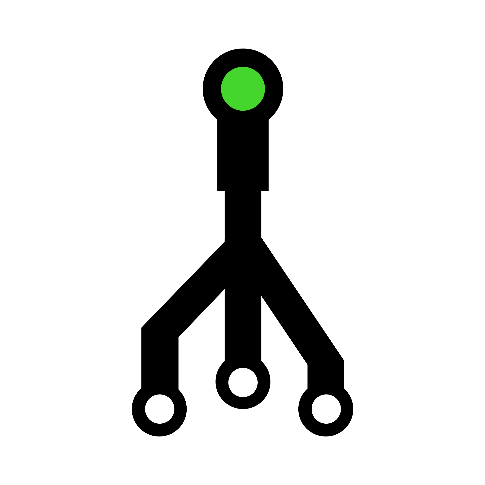
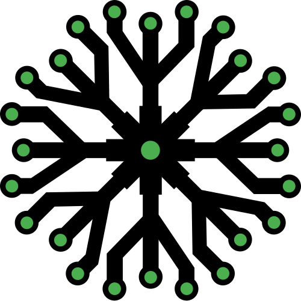
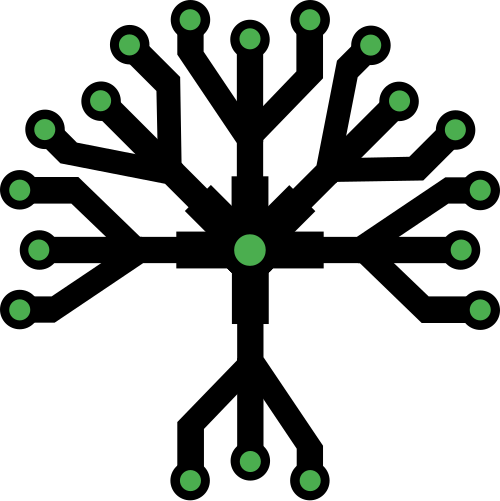
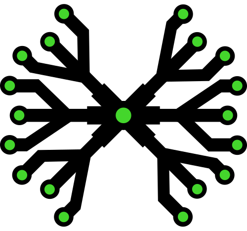

  

<h1 align="center">FORKTEX</h1>

  <b>We build software that ships.</b> 
  Software engineering firm, Bucharest · Europe and North America since 2021 
  <a href="https://forktex.com"><b>forktex.com</b></a>

### Platforms

<table>
  <tr>
    <td align="center" width="50%">
      <a href="https://forktex.com/products/cloud"> <b>ForkTex Cloud</b></a>
      
A declarative deployment platform. One <code>forktex.json</code> manifest becomes a local Docker Compose stack for development and an Ansible-managed VPS deployment in production, with blue/green slots, automatic DNS and Let's Encrypt certificates. Driven by a FastAPI controller and a typed Python SDK.

      <a href="https://cloud.forktex.com">cloud.forktex.com ↗</a>
    </td>
    <td align="center" width="50%">
      <a href="https://forktex.com/products/network"> <b>ForkTex NetWork</b></a>
      
A social and collaboration network for people and companies: profiles, a feed, connections and messaging. Companies get a public page, channels where members talk, a contact inbox and partnerships, with roles and permissions. Web, iOS and Android from one client.

      <a href="https://network.forktex.com">network.forktex.com ↗</a>
    </td>
  </tr>
  <tr>
    <td align="center" width="50%">
      <a href="https://forktex.com/products/ai"> <b>ForkTex AI</b></a>
      
A capability-first AI platform: chat with streaming and structured output, embeddings, document extraction, audio and video transcription, knowledge and retrieval, and an MCP surface, behind one typed API with a Python SDK. The capability is named, not the vendor.

      <b>Coming soon</b>
    </td>
    <td align="center" width="50%">
      <a href="https://forktex.com/products/erp"> <b>ForkTex ERP</b></a>
      
A multi-tenant business platform on the <code>forktex</code> substrate, built layer by layer: identity and access, then parties, invoices with a lifecycle, ingestion and campaigns. Each organisation's data is kept apart. One API, one client for Android, iOS and the web.

      <b>Coming soon</b>
    </td>
  </tr>
</table>

### Open source

Eight Python libraries, each on GitHub and PyPI. AGPL-3.0-or-later, or a commercial licence. All build on `forktex`.

<table>
  <tr>
    <td align="center" width="50%">
      
      
The shared Python substrate: structured logs with a trace id, one error hierarchy with stable codes, typed models, PostgreSQL, Redis, S3 and a FastAPI app factory.

    </td>
    <td align="center" width="50%">
      
      
The ForkTex Standard of Delivery, and the tool that checks it. A repository binds atoms such as <code>test</code>, <code>audit</code> and <code>publish</code> to its own commands in one <code>fsd.toml</code>.

    </td>
  </tr>
  <tr>
    <td align="center" width="50%">
      
      
Durable workflows that run entirely on PostgreSQL: cron schedules with leader takeover, pauses for a person's approval, and LLM tool calls that survive a restart.

    </td>
    <td align="center" width="50%">
      
      
Tables declared as data by your tenants, users or agents: typed columns, links and indexes, with validated writes and one query language. No migration, no deploy, one schema in your own PostgreSQL.

    </td>
  </tr>
  <tr>
    <td align="center" width="50%">
      
      
Send and receive e-mail from any Python process: SMTP to send, IMAP to read, failures classified from the protocol codes, bounces matched to the message that caused them.

    </td>
    <td align="center" width="50%">
      
      
Working memory for scripts and agents: typed records loaded into one immutable graph, searched and packed into a token budget by retrieval pipelines, published as one versioned file and served over MCP.

    </td>
  </tr>
  <tr>
    <td align="center" width="50%">
      
      
Invoices, contracts and reports generated as HTML and PDF from one typed record: your own document types, typed blocks, your theme and your jurisdiction's formats, and PDFs ready to sign.

    </td>
    <td align="center" width="50%">
      
      
Harvest public APIs politely, and prove what was harvested: capped result sets are split until the server answers in full, and a coverage report names what was not reached.

    </td>
  </tr>
</table>

### Reach out

<table>
  <tr>
    <td align="center" width="50%"></td>
    <td align="center" width="50%"></td>
  </tr>
</table>

### Social

<table>
  <tr>
    <td align="center" width="50%"></td>
    <td align="center" width="50%"></td>
  </tr>
  <tr>
    <td align="center" width="50%"></td>
    <td align="center" width="50%"></td>
  </tr>
</table>

